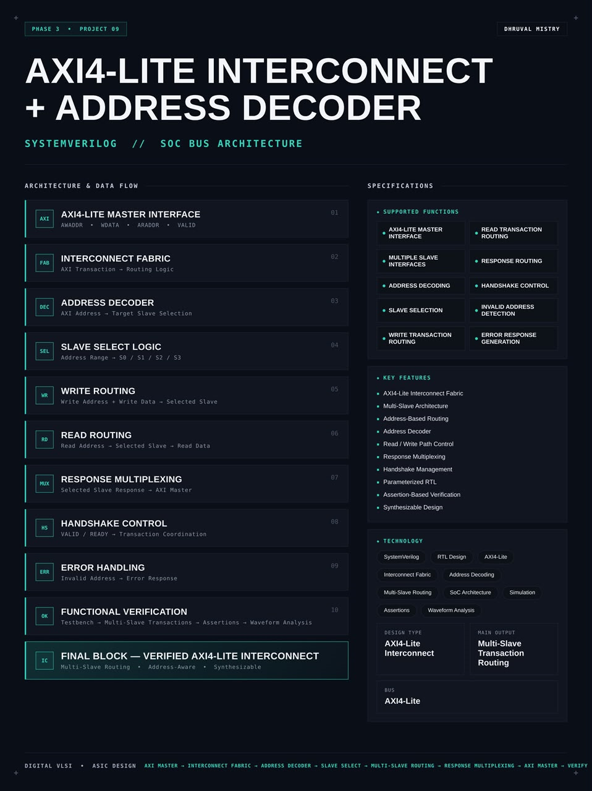
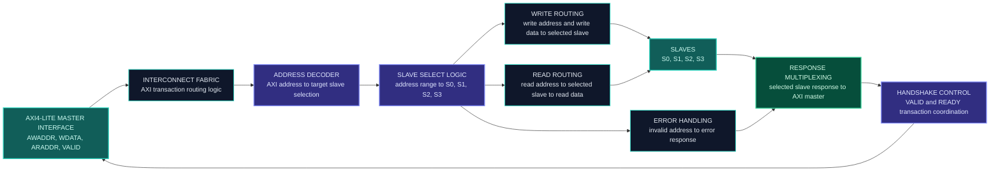
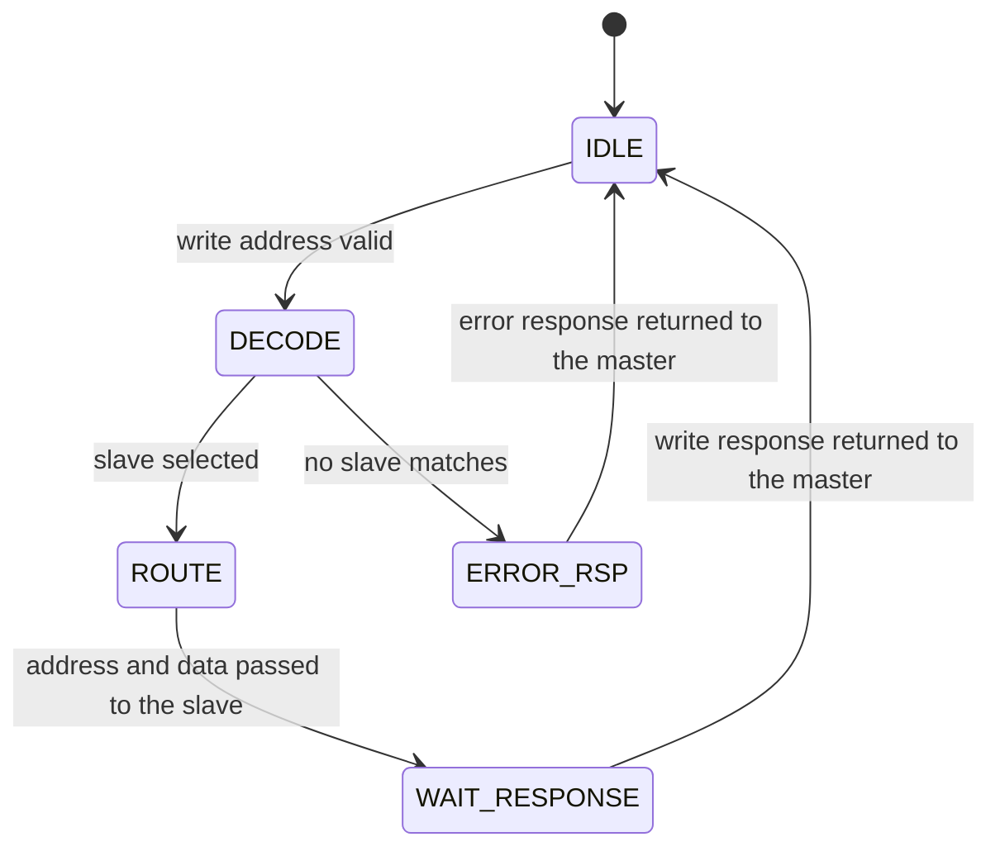
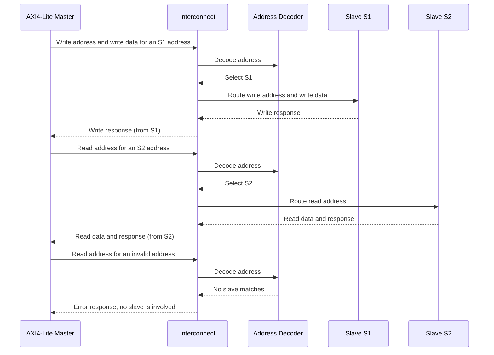
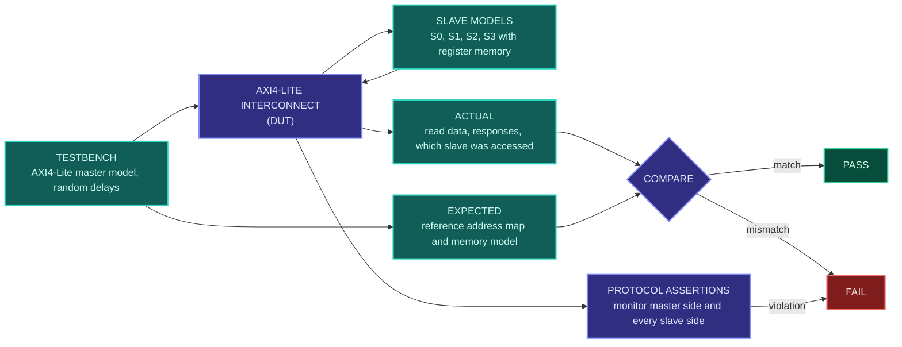

<div align="center">




<b>A synthesizable AXI4-Lite interconnect that decodes the address of every transaction and routes it from one master to the right one of several slaves, with response multiplexing and error handling, written in SystemVerilog.</b>

<br/>


<br/>

[Overview](#overview) |
[At a Glance](#project-at-a-glance) |
[Background](#background-bus-interconnects-and-address-decoding) |
[Functions](#supported-functions) |
[Architecture](#architecture) |
[Functional Description](#functional-description) |
[Address Decoding and Routing](#address-decoding-and-routing) |
[Interface](#interface) |
[Operating Sequence](#operating-sequence) |
[Getting Started](#getting-started) |
[Verification](#verification) |
[Synthesis](#synthesis) |
[Applications](#applications) |
[FAQ](#faq) |
[License](#license)

</div>

---

## Overview

This project implements an **AXI4-Lite interconnect with an address decoder** in **SystemVerilog**. It sits between one **AXI4-Lite master** and **multiple AXI4-Lite slaves**, and makes all of the slaves look like one memory map to the master. The master sends an ordinary AXI4-Lite read or write, and the interconnect works out which slave owns that address and forwards the transaction to it.

The **AXI4-Lite master interface** accepts the five AXI4-Lite channels from the master. An **address decoder** compares the address with the address range of each slave, and **slave select logic** turns the result into a selection of one of the slaves, S0, S1, S2 and so on. **Write routing** sends the write address and the write data to the selected slave, and **read routing** sends the read address to it and brings the read data back. **Response multiplexing** picks the response of the selected slave and returns it to the master. **Handshake control** coordinates the VALID and READY signals between the master side and the slave side, and **error handling** answers any access to an invalid address with an error response, without bothering any slave.

The design is **parameterized**, written in a **synthesis-friendly** style, checked with a testbench made of an AXI4-Lite master model and several slave models, protocol **assertions** and waveform analysis, and packaged as a reusable SoC bus building block.

<table>
<tr>
<td width="50%" valign="top">

#### Objectives
- Build an AXI4-Lite interconnect fabric for one master and several slaves
- Decode the address of each transaction against a slave address map
- Route write address and write data to the selected slave
- Route the read address to the selected slave and return the read data
- Multiplex the responses of the slaves back to the master
- Keep the VALID and READY handshakes correct on both sides
- Detect invalid addresses and answer them with an error response
- Verify routing, responses and protocol rules with assertions

</td>
<td width="50%" valign="top">

#### Key Features
- AXI4-Lite interconnect fabric
- Multi-slave architecture
- Address-based routing
- Address decoder
- Read and write path control
- Response multiplexing
- Handshake management
- Parameterized RTL
- Assertion-based verification
- Synthesizable design

</td>
</tr>
</table>

---

## Project at a Glance

| Attribute | Detail |
|:--|:--|
| **Design type** | AXI4-Lite interconnect with address decoder |
| **Description language** | SystemVerilog (RTL) |
| **Bus** | AMBA AXI4-Lite |
| **Topology** | One master interface, multiple slave interfaces |
| **Routing method** | Address-based, from a slave address map |
| **Channels routed** | Write address, write data, write response, read address, read data |
| **Response handling** | Response multiplexing from the selected slave |
| **Invalid address** | Detected and answered with an error response |
| **Handshake** | VALID / READY coordination on the master side and every slave side |
| **Main output** | Multi-slave transaction routing |
| **Configurability** | Parameterized slave count, address width, data width and address map |
| **Checking** | Master and slave models, protocol assertions, waveform analysis |
| **Functions** | 10 (master interface, slave interfaces, decoding, selection, routing, responses, handshakes, errors) |
| **Simulation** | Verilator |
| **Waveform analysis** | GTKWave |
| **Synthesis** | Yosys |
| **License** | MIT |

---

## Background: Bus Interconnects and Address Decoding

A system-on-chip has one or more **masters**, such as a processor, and many **slaves**, such as memories, timers, GPIO blocks and configuration registers. A master only knows one thing: an **address**. It does not know how many slaves exist or which one is at which place. Something has to look at the address and send the transaction to the right slave. That something is the **interconnect**.

An interconnect with **one master and several slaves** is the simplest form, and it is built from two ideas:

1. **Address decoding.** Every slave owns a range of addresses. The decoder compares the incoming address with these ranges and finds out which slave is meant.
2. **Routing.** The transaction is then steered to that slave only: the master's signals are connected to the selected slave, and the selected slave's signals are connected back to the master. The other slaves see nothing.

On the master side the interconnect behaves like a single AXI4-Lite slave. On the slave side it behaves like an AXI4-Lite master that talks to many slaves. Because AXI4-Lite has five independent channels, each channel needs its own routing:

| Channel | Direction | Routed how |
|:--|:-:|:--|
| Write address (AW) | Master to slave | Decoded, then steered to the selected slave |
| Write data (W) | Master to slave | Steered to the slave chosen by the matching write address |
| Write response (B) | Slave to master | Taken from the selected slave by a multiplexer |
| Read address (AR) | Master to slave | Decoded, then steered to the selected slave |
| Read data (R) | Slave to master | Taken from the selected slave by a multiplexer |

An address that belongs to **no** slave also has to be handled. If the interconnect simply ignored it, the master would wait forever. Instead the interconnect answers it itself with an **error response**, which keeps the bus from hanging and tells software that it used a bad address.

---

## Supported Functions

| Group | Function | Description |
|:--|:--|:--|
| **Interfaces** | `AXI4-LITE MASTER INTERFACE` | Accepts the five AXI4-Lite channels from the master |
| **Interfaces** | `MULTIPLE SLAVE INTERFACES` | Provides one AXI4-Lite interface for each slave |
| **Decode** | `ADDRESS DECODING` | Compares the address with the slave address ranges |
| **Decode** | `SLAVE SELECTION` | Turns the decode result into the selection of one slave |
| **Routing** | `WRITE TRANSACTION ROUTING` | Steers the write address and write data to the selected slave |
| **Routing** | `READ TRANSACTION ROUTING` | Steers the read address to the selected slave |
| **Response** | `RESPONSE ROUTING` | Returns the response and read data of the selected slave to the master |
| **Control** | `HANDSHAKE CONTROL` | Coordinates VALID and READY across the interconnect |
| **Errors** | `INVALID ADDRESS DETECTION` | Recognizes an address that matches no slave |
| **Errors** | `ERROR RESPONSE GENERATION` | Answers an invalid address with an error response |

---

## Architecture

The design is organized as the AXI4-Lite master interface, the interconnect fabric with its routing logic, the address decoder with slave select logic, the write and read routing paths, the response multiplexing, the handshake control, the error handling and the slave interfaces.

#### Block diagram

```text
                                  +----------------------------------------------------+
                                  |        AXI4-LITE INTERCONNECT + ADDRESS DECODER    |
                                  |                                                    |
                                  |        +--------------------------------+          |
   AWADDR / ARADDR  ------------->|------->|        ADDRESS DECODER         |          |
                                  |        |  address range compare         |          |
                                  |        +---------------+----------------+          |
                                  |                        | match per slave           |
                                  |        +---------------v----------------+          |
                                  |        |       SLAVE SELECT LOGIC       |          |
                                  |        |    S0 / S1 / S2 / S3 / none    |          |
                                  |        +--+---------+---------+------+--+          |
                                  |           |         |         |      |             |
                                  |   select S0    select S1  select S2  | no match    |
                                  |           |         |         |      v             |
  +-----------------+             |           v         v         v   +---------+      |
  |  AXI4-LITE      |  AW,W,AR    |   +----------------------------+  |  ERROR  |      |
  |  MASTER         |------------>|-->|                            |  | HANDLING|      |
  |  INTERFACE      |             |   |   INTERCONNECT FABRIC      |  | (invalid|      |
  |                 |  B, R       |   |   WRITE ROUTING            |  | address)|      |
  |                 |<------------|<--|   READ ROUTING             |<-+---------+      |
  +-----------------+             |   |   RESPONSE MULTIPLEXING    |                   |
                                  |   |   HANDSHAKE CONTROL        |                   |
                                  |   +----+--------+--------+-----+--------+          |
                                  |        |        |        |              |          |
                                  +--------|--------|--------|--------------|----------+
                                           v        v        v              v
                                       +------+ +------+ +------+       +------+
                                       | S0   | | S1   | | S2   |  ...  | S(N-1)|
                                       |AXI4- | |AXI4- | |AXI4- |       |AXI4- |
                                       | Lite | | Lite | | Lite |       | Lite |
                                       +------+ +------+ +------+       +------+
```

#### Data flow



#### Block breakdown

| # | Block | Role |
|:-:|:--|:--|
| `01` | **AXI4-Lite Master Interface** | AWADDR, WDATA, ARADDR and VALID from the master |
| `02` | **Interconnect Fabric** | AXI transaction routing logic |
| `03` | **Address Decoder** | AXI address to target slave selection |
| `04` | **Slave Select Logic** | Address range to S0, S1, S2 or S3 |
| `05` | **Write Routing** | Write address and write data to the selected slave |
| `06` | **Read Routing** | Read address to the selected slave, and read data back |
| `07` | **Response Multiplexing** | Selected slave response to the AXI master |
| `08` | **Handshake Control** | VALID and READY transaction coordination |
| `09` | **Error Handling** | Invalid address to error response |
| `10` | **Functional Verification** | Testbench, multi-slave transactions, assertions and waveform analysis |

> **Final design block:** `AXI MASTER -> INTERCONNECT FABRIC -> ADDRESS DECODER -> SLAVE SELECT -> MULTI-SLAVE ROUTING -> RESPONSE MULTIPLEXING -> AXI MASTER`

---

## Functional Description

#### AXI4-Lite master interface
The master-facing side. It receives the write address (`AWADDR`, `AWVALID`), the write data (`WDATA`, `WVALID`) and the read address (`ARADDR`, `ARVALID`) from the master, and returns the write response, read data and the ready signals. Seen from the master, the interconnect is a single AXI4-Lite slave.

#### Interconnect fabric
The routing logic that connects the master interface to the slave interfaces. It contains the write routing, the read routing, the response multiplexing and the handshake control, and it is controlled by the output of the address decoder.

#### Address decoder
Compares the address of a transaction with the address range of every slave. The result is one match signal per slave. The write address and the read address are decoded separately, since reads and writes are independent.

#### Slave select logic
Turns the match signals into the selection of exactly one slave, S0, S1, S2 or S3, or into a "no match" result when the address belongs to nobody. The selection is held for the whole transaction, so the data and the response follow the address to the same slave.

#### Write routing
A write uses two channels. The write address goes to the slave chosen by the decoder. The write data has no address of its own, so it is sent to the same slave that was chosen for the write address of that transaction. If the data arrives before the address, the interconnect holds it back until the address has been decoded.

#### Read routing
The read address is steered to the selected slave. The slave returns the read data on its read data channel, and the read routing delivers it to the master.

#### Response multiplexing
The master has one write response channel and one read data channel, but every slave has its own. A multiplexer picks the response and the read data of the selected slave and passes them to the master. It also routes the master's `BREADY` and `RREADY` back to that slave.

#### Handshake control
Coordinates the VALID and READY signals so that a transfer on the master side happens together with the matching transfer on the slave side. It makes sure that no request is duplicated, no request is lost and no VALID signal is dropped before its READY arrives.

#### Error handling
When the decoder finds no slave for an address, the interconnect does not forward the transaction. It completes the handshake on the master side by itself and returns an error response. For a write it accepts the address and the data and returns an error on the write response channel. For a read it accepts the address and returns an error on the read data channel. This keeps the bus from hanging on a bad address.

---

## Address Decoding and Routing

#### Address map

Each slave owns a range given by a base address and a size. The decoder compares the address with these ranges.

| Slave | Base address | Size | Address range |
|:--|:-:|:-:|:--|
| S0 | `TBD` | `TBD` | `TBD` |
| S1 | `TBD` | `TBD` | `TBD` |
| S2 | `TBD` | `TBD` | `TBD` |
| S3 | `TBD` | `TBD` | `TBD` |

The base addresses, sizes and the number of slaves are set through parameters and are defined in the RTL sources under `rtl/`.

#### Illustrative address map

The values below are only an example of how a map can look. They are not the map of this IP.

| Slave | Base address | Size | Address range |
|:--|:-:|:-:|:--|
| S0 | `0x0000` | 4 KB | `0x0000` to `0x0FFF` |
| S1 | `0x1000` | 4 KB | `0x1000` to `0x1FFF` |
| S2 | `0x2000` | 4 KB | `0x2000` to `0x2FFF` |
| S3 | `0x3000` | 4 KB | `0x3000` to `0x3FFF` |
| none | everything else | not applicable | Error response |

#### Decoding rule

For each slave, the decoder asks whether the address lies inside the range of that slave:

```text
match[i]  =  ( address >= BASE[i] )  AND  ( address < BASE[i] + SIZE[i] )
```

When every range has a size that is a power of two and starts on a multiple of its size, the comparison needs only the upper address bits:

```text
match[i]  =  ( address [ADDR_WIDTH-1 : log2(SIZE[i])]  ==  BASE[i] [ADDR_WIDTH-1 : log2(SIZE[i])] )
```

This is cheaper in hardware, because the low bits, which select a register inside the slave, are not compared at all.

#### Decode result

| Matches found | Meaning | Action |
|:-:|:--|:--|
| Exactly one | Address belongs to one slave | Route the transaction to that slave |
| None | Address belongs to no slave | Answer with an error response |
| More than one | Address ranges overlap | Not allowed. The map must not overlap |

A correct address map never produces more than one match, and an assertion checks that.

#### Write routing in detail



| State | Behavior |
|:--|:--|
| `IDLE` | Waits for a write address from the master |
| `DECODE` | Decodes the write address and chooses the slave |
| `ROUTE` | Passes the write address and the write data to the selected slave, with the handshakes coordinated |
| `WAIT_RESPONSE` | Holds the selection until the slave's write response has been passed to the master |
| `ERROR_RSP` | Takes the address and the data itself and returns the error response |

The read path follows the same idea with fewer steps: decode the read address, pass it to the selected slave, hold the selection until the read data has been returned.

#### Why the selection is held

AXI4-Lite has no transaction IDs. The master can only tell which response belongs to which request by the order in which they arrive. If the interconnect sent several requests to different slaves at once, the responses could come back in a different order than the requests. To keep the order correct, the interconnect holds the selected slave until its response has been returned, and accepts the next request on that path only after that. The number of outstanding transactions allowed is listed in the configuration table.

#### Error response

| Access | Response |
|:--|:--|
| Valid address | Response of the selected slave, passed through unchanged |
| Invalid address, write | Error response on the write response channel |
| Invalid address, read | Error response on the read data channel, with an error code and a defined data value |

The standard response code for an address with no slave is DECERR (`2'b11`). The code and the read data value returned for an invalid address are listed in the configuration table. An error response from a slave itself (for example SLVERR) is passed through to the master unchanged.

#### Cost of slaves (illustrative)

| Quantity | Formula | Example for 4 slaves, 32-bit data |
|:--|:--|:--|
| Address comparators | one per slave, per decoded address | 4 for writes and 4 for reads |
| Write address and data steering | one fan-out per slave | 4 sets of AW and W outputs |
| Read data multiplexer | one N-to-1 multiplexer | 4-to-1, 32 bits wide plus response |
| Write response multiplexer | one N-to-1 multiplexer | 4-to-1, 2 bits wide |

Each additional slave adds one comparator, one more set of output signals and one more input on each response multiplexer, so the cost grows with the slave count.

---

## Interface

#### Ports

| Port group | Direction | Description |
|:--|:-:|:--|
| `ACLK`, `ARESETn` | Input | Clock and active-low reset |
| Master-side write address channel | In (AWADDR, AWPROT, AWVALID), out (AWREADY) | Write address from the master |
| Master-side write data channel | In (WDATA, WSTRB, WVALID), out (WREADY) | Write data from the master |
| Master-side write response channel | Out (BRESP, BVALID), in (BREADY) | Write response to the master |
| Master-side read address channel | In (ARADDR, ARPROT, ARVALID), out (ARREADY) | Read address from the master |
| Master-side read data channel | Out (RDATA, RRESP, RVALID), in (RREADY) | Read data and response to the master |
| Slave-side channels, one set for each slave | Mirror of the master-side channels, with the directions reversed | Connect to S0, S1, S2 and so on |

Exact port names, widths and signal polarity are defined in the RTL sources under `rtl/`.

#### Parameters and configuration

| Item | Value |
|:--|:-:|
| Number of slaves | `TBD` |
| Address width | `TBD` |
| Data width (32 or 64 bits) | `TBD` |
| Base address of each slave | `TBD` |
| Size of each slave range | `TBD` |
| Outstanding transactions per path | `TBD` |
| Response code for an invalid address | `TBD` |
| Read data value for an invalid address | `TBD` |
| Support for `WSTRB` and protection signals | `TBD` |

---

## Operating Sequence

Every transaction follows the same path: AXI master, interconnect fabric, address decoder, slave select, multi-slave routing, response multiplexing, and back to the master.



1. **Reset.** `ARESETn` brings the interconnect to its idle state. All VALID outputs are low.
2. **Write.** The master presents a write address and write data. The interconnect decodes the address, selects the slave, passes the address and the data on, waits for the write response and returns it to the master.
3. **Read.** The master presents a read address. The interconnect decodes it, selects the slave, passes the address on, waits for the read data and returns it to the master.
4. **Different slaves.** Consecutive transactions can go to different slaves. The interconnect changes the selection for each transaction.
5. **Invalid address.** The interconnect finishes the transaction itself with an error response. No slave sees the access.
6. **Idle.** After the response, the selection is released and the next transaction can start.

---

## Repository Structure

```text
axi4-lite-interconnect-address-decoder/
├── rtl/
│   ├── axil_addr_decoder.sv    # Address decoder and slave select logic
│   ├── axil_write_router.sv    # Write address and write data routing
│   ├── axil_read_router.sv     # Read address routing
│   ├── axil_resp_mux.sv        # Response and read data multiplexing
│   ├── axil_error_slave.sv     # Error responder for invalid addresses
│   └── axil_interconnect.sv    # Top-level interconnect
├── tb/
│   ├── axil_master_bfm.sv      # AXI4-Lite master model (read and write tasks)
│   ├── axil_slave_model.sv     # AXI4-Lite slave model with a small register memory
│   ├── axil_protocol_checker.sv# AXI4-Lite protocol assertions
│   └── axil_interconnect_tb.sv # Self-checking testbench
├── sim/
│   └── waves.vcd               # Generated waveform dump
├── synth/
│   ├── synth.ys                # Yosys synthesis script
│   ├── axil_ic_netlist.v       # Gate-level netlist
│   └── synth_report.txt        # Yosys stat report
├── LICENSE
└── README.md
```

---

## Technology Stack

| Tool | Role in this project |
|:--|:--|
|  | RTL design, bus models, testbench and assertions |
|  | Compiles and simulates the design |
|  | Views the simulation waveforms |
|  | Synthesizes the RTL to a gate-level netlist |

---

## Getting Started

#### Prerequisites

| Tool | Purpose | Version |
|:--|:--|:--|
| Verilator | RTL simulation | 5.x or later |
| GTKWave | Waveform viewer | Any recent |
| Yosys | RTL synthesis | Any recent |

```bash
# Ubuntu / Debian
sudo apt update
sudo apt install verilator gtkwave yosys
```

#### 1. Clone

```bash
git clone https://github.com/dhruvalmistry2007/axi4-lite-interconnect-address-decoder.git
cd axi4-lite-interconnect-address-decoder
```

#### 2. Simulate

The testbench uses delays for the bus models, so the simulation is built with timing support.

```bash
verilator --binary --timing --trace --assert -Wall --top-module axil_interconnect_tb \
  rtl/axil_addr_decoder.sv rtl/axil_write_router.sv rtl/axil_read_router.sv \
  rtl/axil_resp_mux.sv rtl/axil_error_slave.sv rtl/axil_interconnect.sv \
  tb/axil_master_bfm.sv tb/axil_slave_model.sv tb/axil_protocol_checker.sv tb/axil_interconnect_tb.sv
./obj_dir/Vaxil_interconnect_tb
```

#### 3. View waveforms

```bash
gtkwave sim/waves.vcd
```

#### 4. Synthesize

```bash
yosys -p "read_verilog -sv rtl/axil_addr_decoder.sv rtl/axil_write_router.sv rtl/axil_read_router.sv rtl/axil_resp_mux.sv rtl/axil_error_slave.sv rtl/axil_interconnect.sv; synth -top axil_interconnect; stat; write_verilog synth/axil_ic_netlist.v"
```

---

## Verification

The testbench has an **AXI4-Lite master model**, several **slave models** with small register memories, and a **reference model** of the address map. The master reads and writes addresses in every slave and in the invalid region. The slave models can delay their READY and VALID signals at random. A **protocol checker** made of assertions monitors the master side and every slave side on each clock edge, and the results are inspected as waveforms.



#### Test plan

| Area | Scenario | Expected behavior |
|:--|:--|:--|
| Reset | Apply `ARESETn` | Interconnect is idle and all VALID outputs are low |
| Write to each slave | Write a register in every slave | Only the addressed slave receives the write and the response is OKAY |
| Read from each slave | Read back every register written | Data matches and comes from the addressed slave |
| Range boundaries | Access the first and last address of every slave range | Each address reaches its own slave |
| Just outside a range | Access the address just below and just above each range | The access goes to the neighbor slave or to the error path, as the map defines |
| Invalid address, write | Write to an address that belongs to no slave | Error response, and no slave sees the write |
| Invalid address, read | Read an address that belongs to no slave | Error response with the defined data, and no slave sees the read |
| Address before data | Send the write address first, the write data later | Data is routed to the slave chosen by the address |
| Data before address | Send the write data first, the write address later | Data is held back until the address is decoded, then routed correctly |
| Slave backpressure | Slaves delay their READY and VALID signals | The master sees correct, stable handshakes |
| Master backpressure | Master delays `BREADY` and `RREADY` | The interconnect holds the response until it is accepted |
| Back-to-back, same slave | Several transactions to one slave in a row | Every transaction completes with its own response |
| Back-to-back, different slaves | Consecutive transactions to different slaves | Selection changes each time and responses come from the right slave |
| Reads and writes together | Start a read while a write is in progress | Both complete correctly and independently |
| Slave error passthrough | A slave returns an error response | The error reaches the master unchanged |
| Response ordering | Mixed traffic to all slaves | Responses return in the order of the requests |
| Random traffic | Random addresses, data, delays and directions | Reference model and DUT always match |
| Parameter sweep | Re-run with other slave counts, address widths and maps | Behavior stays correct for each configuration |

#### Assertions

| Property | What it checks |
|:--|:--|
| One-hot select | At most one slave is selected for any transaction |
| No overlap | No address matches more than one slave range |
| Only the selected slave | VALID signals reach the selected slave only, and all others stay low |
| No access to slaves on invalid address | An invalid address never reaches any slave |
| Response from the selected slave | The response and read data on the master side come from the selected slave |
| VALID stability | On every interface, VALID stays high until its READY |
| Payload stability | Address, data and response signals do not change while VALID is high and READY is low |
| One response per request | The number of responses equals the number of requests, and no request is lost |
| Response ordering | Responses return in the order of the requests |
| Legal response codes | Response codes are never EXOKAY |
| Reset state | After reset the interconnect is idle and all VALID outputs are low |

#### Coverage matrix

| Area | Functions checked | Result |
|:--|:--|:-:|
| Interfaces | AXI4-Lite master interface, multiple slave interfaces | `TBD` |
| Decode | Address decoding, slave selection | `TBD` |
| Routing | Write transaction routing, read transaction routing, response routing | `TBD` |
| Control | Handshake control | `TBD` |
| Errors | Invalid address detection, error response generation | `TBD` |
| Checking | Assertion-based verification | `TBD` |

#### Waveform analysis checklist

| Signal | What to confirm |
|:--|:--|
| `ACLK` and `ARESETn` | Reset puts the interconnect in its idle state |
| Master-side `AWADDR` and `ARADDR` | Address matches the slave that is later accessed |
| Slave select | Exactly one slave selected per valid address, none for an invalid one |
| Slave-side VALID signals | Only the selected slave sees VALID |
| Master-side `AWREADY`, `WREADY`, `ARREADY` | Follow the READY of the selected slave |
| Master-side `BVALID`, `RVALID` | Appear only after the selected slave responds, or after the interconnect error response |
| `BRESP` and `RRESP` | OKAY from good accesses, error code for invalid ones |
| `RDATA` | Matches the data of the selected slave |

---

## Synthesis

The RTL is synthesized with **Yosys** to confirm that the design is synthesizable. The flow reads the SystemVerilog sources, elaborates the design hierarchy, maps it to generic logic cells, prints a cell statistics report and writes the gate-level netlist. The netlist and the report are stored in [`synth/`](synth/).


| Step | Command | Purpose |
|:--|:--|:--|
| Read | `read_verilog -sv` | Loads the SystemVerilog RTL |
| Synthesize | `synth -top axil_interconnect` | Elaborates and maps the design to generic gates |
| Report | `stat` | Prints cell and wire statistics |
| Export | `write_verilog` | Writes the gate-level netlist |

#### Results

| Metric | Value |
|:--|:-:|
| Top module | `axil_interconnect` |
| Total cells | `TBD` |
| Flip-flops | `TBD` |
| Multiplexer cells | `TBD` |
| Comparator logic | `TBD` |
| Wires / wire bits | `TBD` |
| Logic depth / critical path | `TBD` |
| Area | `TBD` |

---

## Design Considerations

| Aspect | Approach |
|:--|:--|
| **Topology** | One master side and N slave sides, with the slave count set by a parameter |
| **Decoding** | Address range compare, using only the upper bits when ranges are aligned powers of two |
| **Routing** | Write address and write data of one transaction always go to the same slave |
| **Ordering** | The selection is held until the response returns, so responses cannot be reordered |
| **Handshakes** | Every interface follows VALID and READY rules, and a request is passed on exactly once |
| **Error handling** | An invalid address is answered by the interconnect itself, so the bus never hangs |
| **Passthrough** | Slave error responses reach the master unchanged |
| **Configurability** | Slave count, widths and address map set through parameters |
| **Synthesis** | Synthesizable RTL structure, targeting a Yosys flow |
| **Verification** | Master and slave models, reference map, protocol assertions and waveform inspection |

#### Current limitations
- One master only, so there is no arbitration between several masters
- Single outstanding transaction per path, with no pipelining across slaves
- Single clock domain for the master and all slaves
- The address map is fixed when the design is built
- Simulation-based verification only, with no formal verification

---

## Applications

- Connecting a processor to several memory-mapped peripherals in an SoC
- Building the register fabric of a custom accelerator or FPGA design
- Exposing many AXI4-Lite register blocks through one control port
- Reference design for address decoding and bus routing
- Starting point for multi-master interconnects with arbitration
- Teaching design for AXI4-Lite channels, handshakes and SoC bus architecture

---

## Customization

#### Change the number of slaves and the address map

Set the slave count and the base address and size of every slave through the parameters when the interconnect is instantiated.

```systemverilog
axil_interconnect #(
    .NUM_SLAVES (4),
    .ADDR_WIDTH (16),
    .DATA_WIDTH (32),
    .BASE_ADDR  ('{16'h0000, 16'h1000, 16'h2000, 16'h3000}),
    .SIZE       ('{16'h1000, 16'h1000, 16'h1000, 16'h1000})
) u_interconnect (
    // connect the master interface and the slave interfaces
);
```

The parameter names above are illustrative. The actual names are listed in the configuration table and in `rtl/axil_interconnect.sv`.

#### Add a slave

1. Increase the slave count parameter.
2. Add the base address and the size of the new slave, outside all existing ranges.
3. Connect the new AXI4-Lite slave interface.
4. Update the address map table in this README.
5. Add test cases for the new range and its boundaries, and re-run the simulation.

---

## Troubleshooting

| Problem | Likely cause | Fix |
|:--|:--|:--|
| `--binary` option not recognized | Verilator version is older than 5.x | Upgrade Verilator to 5.x or later |
| Delays in the testbench are rejected | Timing support is not enabled | Build with `--timing` |
| `waves.vcd` is not generated | Tracing is not enabled | Build with `--trace` and make sure the testbench calls `$dumpfile` and `$dumpvars` |
| Assertions do not fire | Assertions are not enabled in the simulator | Build with `--assert` |
| Transaction goes to the wrong slave | Address map in the interconnect and the testbench differ | Compare the base addresses and sizes |
| Two slaves selected at once | Address ranges overlap | Fix the address map so that ranges do not overlap |
| Write data reaches the wrong slave | Write data routed before the address was decoded | Hold the data back until the write address is decoded |
| Master hangs on a bad address | No error responder for the unmatched address | Make sure the error path completes the handshakes |
| Response comes from the wrong slave | Response multiplexer select changed too early | Hold the selection until the response handshake is complete |
| Responses out of order | More than one transaction outstanding across slaves | Limit to one outstanding transaction per path |
| Yosys cannot find the top module | `-top` name does not match the module name | Use the exact module name from `rtl/axil_interconnect.sv` |

---

## FAQ

**Why does the master need an interconnect at all?**
A master only issues addresses. The interconnect is what turns one address space into several separate slaves, so the master does not need to know how many slaves exist or where they sit.

**How does the interconnect know which slave to use?**
Every slave owns a range of addresses. The address decoder compares the address of the transaction with these ranges, and the slave whose range contains it is selected.

**Why does the write data follow the write address?**
Write data carries no address. The interconnect remembers which slave was chosen for the write address and sends that transaction's data to the same slave.

**What happens if the address belongs to no slave?**
The interconnect answers the transaction itself with an error response and does not involve any slave. This keeps the master from waiting for a response that would never come.

**Why hold the slave selection until the response returns?**
AXI4-Lite has no transaction IDs. Responses are matched to requests only by order, so the interconnect makes sure that responses cannot arrive in a different order than the requests.

**What is the difference between DECERR and SLVERR?**
DECERR means that no slave exists at the address, and it is generated by the interconnect. SLVERR means that a slave was reached but could not complete the access, and it comes from the slave. The interconnect passes slave errors through unchanged.

**Why Verilator, GTKWave and Yosys?**
They are free, open-source tools that cover simulation, waveform viewing and synthesis, so the whole project can be reproduced without licenses.

---

## Learning Outcomes

- Understanding how an interconnect connects a master to several slaves
- Designing an address decoder with range comparison
- Routing the five AXI4-Lite channels with correct handshakes
- Multiplexing responses and returning them to the master
- Handling invalid addresses with a defined error response
- Writing parameterized, reusable bus RTL
- Writing master and slave bus models and protocol assertions
- Debugging bus transactions with waveform analysis and running RTL synthesis

---

## Design Flow


<div align="center">

`AXI MASTER` | `INTERCONNECT FABRIC` | `ADDRESS DECODER` | `SLAVE SELECT` | `MULTI-SLAVE ROUTING` | `RESPONSE MULTIPLEXING` | `AXI MASTER` | `VERIFY`

</div>

---

## Future Work

- Add several masters with an arbiter and per-master routing
- Add pipelined handling of several outstanding transactions
- Add register slices for timing closure on long paths
- Add support for `WSTRB` byte strobes and `PROT` based access checks
- Add a runtime-configurable address map
- Add a bridge from AXI4-Lite to APB for slow peripherals
- Add formal properties for routing and the AXI4-Lite protocol
- Add self-checking randomized tests with functional coverage
- Run the design through an RTL-to-GDSII flow (OpenLane)

---

## Contributing

Suggestions and improvements are welcome. Open an issue to discuss a change, or submit a pull request with a clear description of what it does and the simulation results that support it.

---

## References

- [Verilator](https://www.veripool.org/verilator/): open-source SystemVerilog simulator
- [GTKWave](https://gtkwave.sourceforge.net/): waveform viewer
- [Yosys Open SYnthesis Suite](https://yosyshq.net/yosys/): open-source RTL synthesis framework
- IEEE Std 1800: SystemVerilog language standard
- Arm AMBA AXI and ACE Protocol Specification (AXI4 and AXI4-Lite)

---

## License

This project is licensed under the **MIT License**. See the [LICENSE](LICENSE) file for details.

---

## Author

<div align="center">

**Dhruval Mistry**

[](https://github.com/dhruvalmistry2007)

<br/>


</div>
